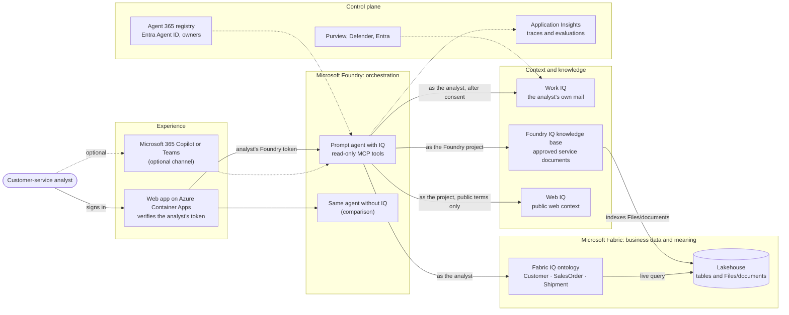

# Reference architecture: the delayed-order scenario

> [!IMPORTANT]
> **Fictional sample.** The company, customers, orders, carrier, documents and mail are invented. Product
> status and licensing below were checked against Microsoft's pages on 19 November 2026, in the week of
> Ignite 2026. They change quickly: confirm them on the linked pages before you rely on them.

A customer-service analyst investigates why a customer's order is late and prepares a reply. This page shows how
work context, enterprise knowledge, business data and public context reach one answer, which Microsoft
capability supplies each part, who owns what, and where a person decides. The [demo guide](README.md) walks
through it live; [governance and operations](governance-and-operations.md) and
[capability selection](capability-selection.md) build on it.

## End to end

Solid lines are what this repository deploys and the demo shows live. Dashed lines are the parts the session
discusses: publishing the same agent to Microsoft 365 Copilot or Teams, registering it in Agent 365, and the
Purview and Defender controls an organization already runs. Nothing on the path writes to a business system:
every tool is read-only, and the analyst sends the reply.

### One question, step by step

| Step | What happens | Who or what decides |
| --- | --- | --- |
| 1 | The analyst signs in with Microsoft Entra ID and asks about order SO-48213 | The analyst |
| 2 | The app's server verifies the token (issuer, audience, tenant, client, scope, user) and forwards it to the Foundry project's Responses API; it holds no secret and builds no prompt | The server's token checks |
| 3 | Foundry runs the agent as the analyst; Foundry roles decide whether they may | Azure RBAC (Foundry User) |
| 4 | Fabric IQ answers the order, customer and shipment question from the live ontology, returning only rows the analyst may read | Fabric workspace and OneLake permissions |
| 5 | Foundry IQ returns passages from the approved documents: the delayed-order policy, the communication guideline, the customs note, the data definitions | The knowledge owners, by what they publish |
| 6 | Work IQ fetches the analyst's own mail about the order, after their one-time consent | Microsoft 365 permissions and the tenant's Work IQ policy |
| 7 | Web IQ adds one line of public context from a query that holds no private term | The tool description and the public-context knowledge base's retrieval instructions |
| 8 | The agent answers with a source marker after each fact, a recommendation, a draft, *Sources* and *Steps* | The shared instructions |
| 9 | The analyst checks the answer, asks a team lead to approve any credit, and sends the reply themselves | **People**: the agent can't send, change or approve anything |

## Roles and boundaries

| Capability | Role in the scenario | What it reaches, and where the data stays | Identity | Runtime | Owner in the organization |
| --- | --- | --- | --- | --- | --- |
| **Fabric IQ** | Business data and its meaning: the live customer, order and shipment facts, as entities and relationships with governed definitions | The ontology is a semantic layer over the lakehouse tables; data stays in OneLake and is queried live, not copied | The analyst (`UserEntraToken`); OneLake security applies | Fabric capacity; the ontology's MCP endpoint | Data owners per domain; the Fabric workspace owner |
| **Foundry IQ** | Enterprise knowledge: what the policy allows, how to word a reply, what a field means | Indexes copies of the approved documents from the lakehouse's `Files/documents` into Azure AI Search | The Foundry project's managed identity: documents are not trimmed per user, so publish only what every user may read | Azure AI Search knowledge base, as an MCP server | Knowledge owners per document; the service owner for the corpus |
| **Work IQ** | Work context: what colleagues wrote about the order, and the customer's deadline | The analyst's own Microsoft 365 mail, inside the Microsoft 365 boundary | The analyst, through OAuth identity passthrough and their consent; permission-trimmed | Microsoft-hosted Work IQ MCP server | The Microsoft 365 administrators; each user for their own mail |
| **Web IQ** | Public context: how customs holds usually work | The public web index; queries leave the organization, so they carry public terms only | The project, with an API key held by Search; no per-user identity | Microsoft-hosted, global, public endpoint | The service owner, under accepted Web IQ terms |
| **Microsoft Foundry** | Orchestration: one prompt agent, its model, instructions and tools | Conversation state in the Foundry project | Each run is the analyst's; agents get Entra agent identities | Foundry Agent Service | The agent's product owner |
| **Copilot Studio** | Not deployed here. A low-code alternative for building the same assistant, a channel, or agent flows for approvals | Power Platform environments, governed by data policies | End-user Entra sign-in; tools can run with user credentials | Microsoft-hosted | Makers in managed environments, under the Power Platform admins |
| **Agent 365** | Not deployed here. The control plane that registers the Foundry agents, assigns owners and sponsors, applies access policy and audits them | Agent inventory and telemetry in the tenant's geography | Entra Agent ID | Not a runtime: the Microsoft 365 admin center | The AI governance board, with IT administrators |

Two boundaries matter most in a review:

- **Identity differs per IQ.** Fabric IQ and Work IQ act as the signed-in user, so their own permissions apply.
  Foundry IQ and Web IQ act as the project, so the corpus must be fit for every user and Web IQ queries must be
  public. A managed identity never replaces the user's token for live business data.
- **Indexed versus live.** Foundry IQ indexes copies of documents, refreshed on a schedule; Fabric IQ, Work IQ and
  Web IQ query live. A document never proves current status: the instructions keep the ontology authoritative.

## Data movement

| Data | Moves from | Moves to | Copied? | Control |
| --- | --- | --- | --- | --- |
| Customer, order and shipment rows | The lakehouse | The agent's context for one answer | No, queried per question | Fabric permissions; the app logs no answer text |
| Approved documents | The repository, through `SeedScenario` | The lakehouse `Files/documents`, then the Search index | Yes, indexed every five minutes | Reviewed publication; insert-only; no overwrite |
| The analyst's mail | Their Microsoft 365 mailbox | The agent's context for one answer | No | Microsoft 365 permissions, consent, Work IQ policy |
| A public query and its results | The agent | The public web index and back | The query leaves the organization | Public terms only; one labelled line |
| Prompts, answers, tool calls | The Foundry run | Application Insights `AppGenAIContent` | Yes, as traces | Readable only with Privileged Monitoring Data Reader |
| App telemetry | The app's server | Application Insights | Yes, value-free | No question, answer, token or user identifier |

## Dependencies

| Dependency | Needed for | Lead time and owner |
| --- | --- | --- |
| Fabric capacity, workspace roles, ontology and deployment-plan tenant settings | Fabric IQ, the documents' lakehouse | Fabric administrator; tenant settings can take days |
| Azure AI Search and the Foundry `embedding` and `chat` models | Foundry IQ and the public-context knowledge base | Platform team; model quota per region |
| Foundry project, `agent` model deployment and per-user Foundry roles | Every answer | Platform team; operator grants per user |
| Work IQ tenant enablement, a Copilot Credits spending policy, administrator and user consent, mailboxes | Work IQ | Global, billing and Microsoft 365 administrators; days |
| Web IQ terms, AppID linking and key | Web IQ | Service owner and a portal step |
| Entra app registrations and tenant-wide consent | Sign-in and Fabric access | Identity administrators |

The [preparation checklist](../../preparation.md) lists every manual gate.

## Customer responsibilities

Microsoft runs the services; the organization owns what flows through them.

- **Data:** definitions, quality, freshness and access for each table, with named owners and stewards
  ([data contract](../../scenario/data/contract.json)).
- **Knowledge:** which documents are approved, their versions and review dates, and that every user may read them
  ([knowledge](../../scenario/knowledge/README.md)).
- **Access:** who may use the agent, the ontology and Work IQ; consent policy; second-user isolation tests.
- **Behavior:** the agent's instructions, tools and evaluation cases, reviewed like code
  ([evaluation cases](../../scenario/evals/README.md)).
- **Decisions:** approvals and sending stay with people; the agent only proposes.
- **Cost and operation:** capacity, credits and quotas; monitoring, incidents and change
  ([operating model](governance-and-operations.md)).
- **Assurance:** security, privacy, compliance and Responsible AI reviews before production use.

## Maturity

As checked on 19 November 2026. "Preview" features come with preview terms and can change without notice.

| Capability | Generally available | In preview | Source |
| --- | --- | --- | --- |
| Work IQ | The Work IQ APIs and MCP server; Retrieve and granular MCP policies were announced as GA at Ignite 2026 | Memory, human-approval agent policies | [Work IQ](https://learn.microsoft.com/microsoft-365/copilot/extensibility/work-iq/) |
| Fabric IQ | Fabric data agents | The IQ workload, ontology, graph, the ontology MCP endpoint and the Foundry Fabric IQ tool; deployment plans | [Fabric IQ](https://learn.microsoft.com/fabric/iq/overview) |
| Foundry IQ | Agentic retrieval and indexed sources | The agent's MCP connection to a knowledge base, MCP-server sources such as Web IQ, remote and Fabric sources | [Foundry IQ](https://learn.microsoft.com/azure/foundry/agents/concepts/what-is-foundry-iq) |
| Web IQ | The search APIs, broadly available from 17 November 2026 | Commerce | [Web IQ](https://learn.microsoft.com/web-iq/overview) |
| Foundry Agent Service | Prompt agents, tracing, evaluations, publishing to Microsoft 365 Copilot and Teams | Guardrails for agents, monitoring, the AI gateway | [Foundry GA status](https://learn.microsoft.com/azure/foundry/concepts/general-availability) |
| Copilot Studio | The product and Work IQ in Copilot Studio | Some harnesses and connected-agent options | [What's new](https://learn.microsoft.com/microsoft-copilot-studio/whats-new) |
| Agent 365 | Generally available for commercial customers since 1 May 2026 | Several Ignite 2026 additions | [Agent 365](https://learn.microsoft.com/microsoft-agent-365/overview) |
| Azure AI Landing Zones | | The reference implementation | [AI Landing Zones](https://github.com/Azure/AI-Landing-Zones) |

Known constraints for a private-networking review: Web IQ has no Private Link and sits outside the Data
Protection Addendum and the EU Data Boundary; the Fabric ontology supports tenant-level private links only;
serverless Search runs no private indexers; Foundry's web grounding is a public endpoint.

## Fitting an existing Azure AI Landing Zone

Microsoft's Cloud Adoption Framework treats AI as a workload in the existing landing zone, not a new one
([CAF AI ready](https://learn.microsoft.com/azure/cloud-adoption-framework/ai/ready)):

- Foundry, Search, the container app, its registry and Application Insights belong in a workload subscription
  and spoke, with the platform team's hub network, private DNS and policies.
- An existing AI gateway in Azure API Management can front the model deployments and, in preview, MCP tools.
- Fabric, Microsoft 365, Copilot Studio and Agent 365 are SaaS surfaces governed through Entra, Purview, Defender
  and their admin centers, not through the landing zone's network.
- This repository's DEV baseline uses authenticated public endpoints. Moving it into the landing zone's private
  networking is a reviewed hardening step that must respect the constraints above.
